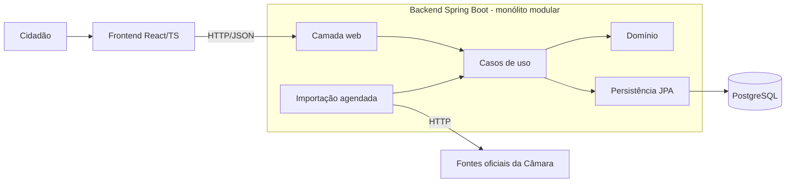

# Arquitetura

Visão inicial; será refinada na Fase 1. Decisões e justificativas em [docs/decisions](../decisions/).

## Visão geral

Monólito modular: uma aplicação Spring Boot, um banco PostgreSQL e um frontend React estático. A importação roda como tarefas agendadas dentro do próprio monólito.



## Módulos previstos (backend)

| Módulo | Responsabilidade |
|---|---|
| `parlamentares` | Deputados e mandatos |
| `proposicoes` | Proposições e tramitações |
| `votacoes` | Votações nominais e votos individuais |
| `despesas` | Despesas parlamentares |
| `acompanhamento` | Seguir deputados e assuntos |
| `atualizacoes` | Registro de mudanças relevantes e resumos semanais |
| `importacao` | Clientes das fontes oficiais, agendamento, controle de execuções |
| `compartilhado` | Utilitários transversais mínimos |

Os módulos são pacotes Java dentro de um único artefato. Regras:

- Comunicação entre módulos só pela API pública do módulo (interfaces/serviços expostos).
- Sem acesso direto às tabelas de outro módulo.
- Avaliar uma verificação automática de fronteiras (ex.: ArchUnit ou Spring Modulith) na Fase 1, com justificativa de dependência.

## Camadas dentro de cada módulo

`web` → `application` → `domain` ← `infrastructure`. O domínio não depende de framework web.

## Estrutura prevista do repositório

```
backend/    Maven, Spring Boot
frontend/   Vite, React, TypeScript
docs/
docker-compose.yml (Fase 1)
```

## Dados

- PostgreSQL como fonte única de verdade da aplicação; migrações com Flyway.
- Cada registro importado guarda identificador oficial, URL de origem e data de importação.
- O frontend consome apenas a API própria, nunca as APIs oficiais diretamente.

## Importação

Ver [ADR 0002](../decisions/0002-estrategia-de-importacao.md).

## Qualidade e CI

- Testes JUnit; integração com PostgreSQL real (Testcontainers, a confirmar).
- GitHub Actions: build e testes de backend e frontend em PRs.

## Segurança e privacidade

- Dados oficiais são públicos, mas dados de usuários (acompanhamentos, e-mail) serão pessoais: LGPD, coleta mínima, decisão própria em ADR antes da Fase 5.
- Sem segredos no repositório.

## Questões em aberto

- Mecanismo de verificação de fronteiras entre módulos.
- Estratégia de cache e paginação da API própria.
- Hospedagem e custo.
- Autenticação de usuários.
